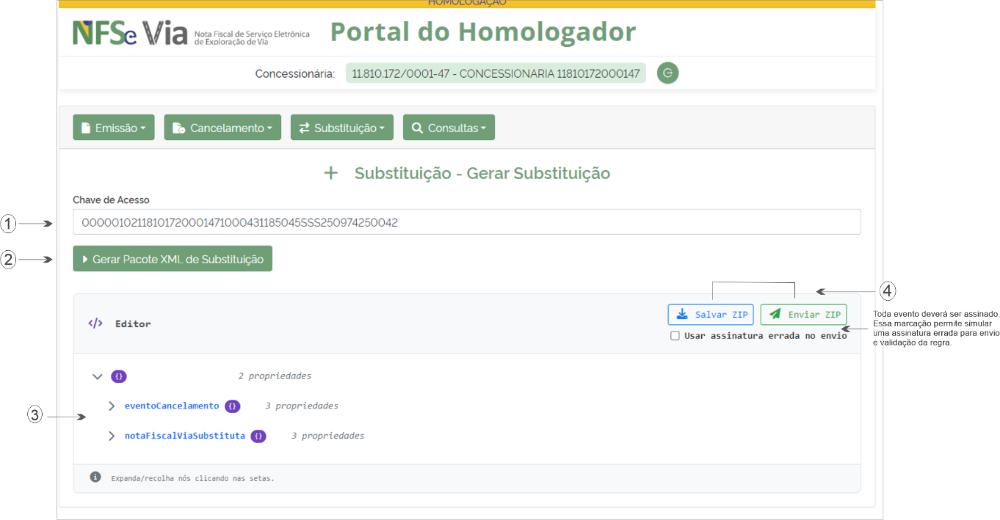
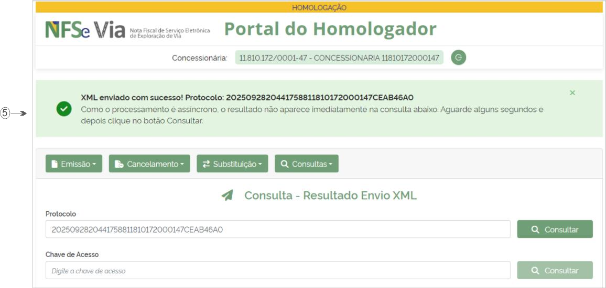

<!-- p.11 -->

# 4.3.3 Substituição – Gerar Evento de Substituição NFS-e Via

<!-- REVISAR p.11: numeração "4.3.3" impressa no original, em subseção da seção 4.4 (mantida como no original) -->

Essa funcionalidade foi desenvolvida para facilitar a homologação do envio de um evento de Substituição de uma NFS-e para o ambiente nacional. Permitindo ao usuário gerar, editar e enviar um pacote com XML de um Evento de Substituição e um xml de Cancelamento de uma NFS-e, sem necessidade de montar manualmente arquivos XML, possibilitando realizar testes de validação de regras no envio do evento.

<!-- p.12 -->

Como funciona na prática:

1. Acesse o menu Substituição – Gerar Substituição, informe a chave da nota que deseja gerar o evento de substituição.
2. Ao clicar em “Gerar Pacote XML de Substituição”, o sistema gerará um xml do evento de cancelamento e um xml do evento de substituição no formato exigido pela API.

*Tela Substituição – Gerar Substituição: chave de acesso da nota, botão Gerar Pacote XML de Substituição e editor do pacote (eventoCancelamento e notaFiscalViaSubstituta).*

3. Após a geração dos xml do evento de cancelamento e da substituição, fica disponível para edição, permitindo alterar dados para validação de regras. Verifique nos requisitos de validação do evento de substituição de uma NFS-e Via, o que é cada campo e quais regras deve ser testadas.
4. Você pode salvar o pacote no formato de um XML em arquivo local, ou enviar o evento de substituição para o ambiente nacional da NFS-e Via, conforme o fluxo da concessionária.
5. Após o envio para o ambiente nacional a API retorna um protocolo de recebimento, que será usando para consultar o resultado da validação do envio do evento de substituição.

<!-- p.13 -->

*Mensagem de envio com sucesso e protocolo gerado para o evento de substituição.*
