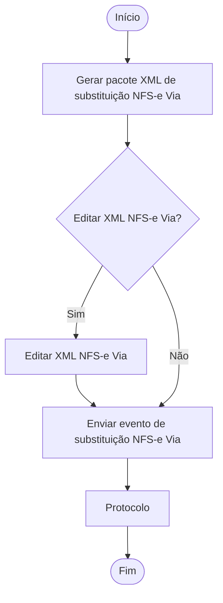

<!-- p.11 -->

# 4.4 Fluxo para homologação – Gerar Evento de Substituição e Enviar

*Para iniciar o processo de geração de um Evento de substituição de uma NFS-e Via é necessário existir uma nota já cadastrada e enviada com sucesso para o ambiente nacional.*

*É gerado um pacote com o XML do evento de cancelamento e um XML do evento de substituição.*

*Esse protocolo poderá ser usado para consultar o resultado da validação do evento de substituição da NFS-e Via.*
