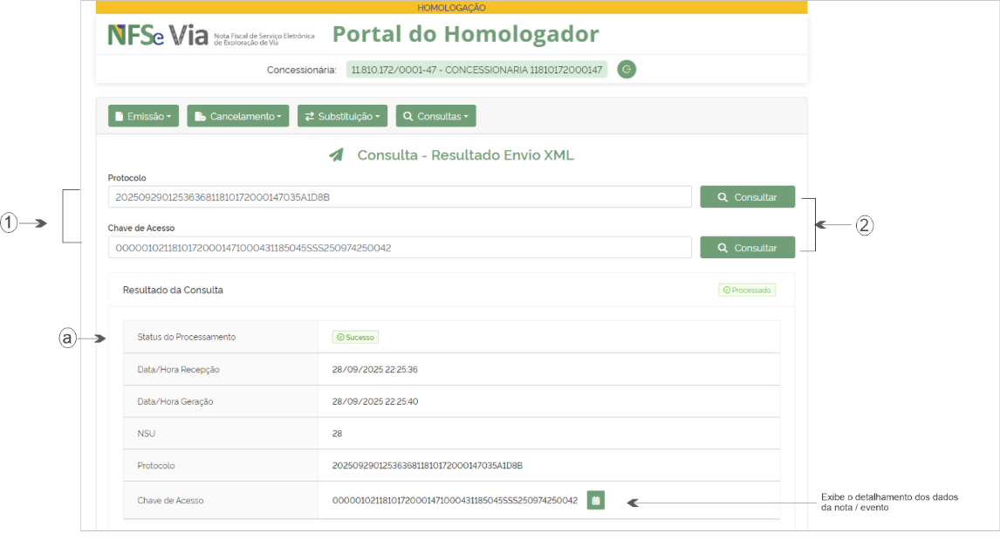
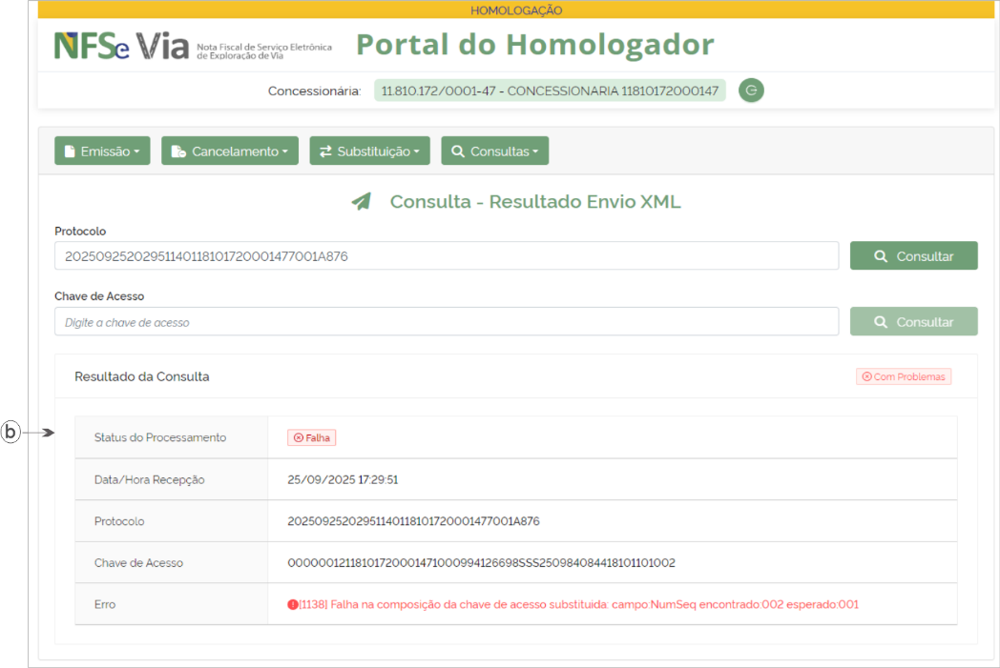

<!-- p.13 -->

# 4.5.1 Consulta – Consultar Resultado do Envio

Essa funcionalidade foi desenvolvida para facilitar a homologação da consulta do resultado do processamento de um envio, cancelamento ou substituição de uma NFS-e Via. A consulta permite verificar se o envio foi validado com sucesso ou se ocorreu algum erro na validação, exibindo o motivo que impediu a internalização da nota ou de seus eventos no ambiente nacional.

<!-- p.14 -->

Como funciona na prática:

1. Acesse o menu Consultas – Resultado Envio XML, informe o protocolo ou a chave da nota/evento que deseja consultar.
2. Ao clicar em “Consultar”, o sistema poderá exibir dois tipos de resultados:
   - a – Sucesso: Informações da Nota/Evento recebido e validado com sucesso.
   - b – Erro: Nota / evento foi recebido mas houve erro na validação.

*Resultado da consulta (a – Sucesso): status Sucesso, com data/hora de recepção e geração, NSU, protocolo e chave de acesso.*

*Resultado da consulta (b – Erro): status Falha, com a mensagem de erro retornada pela validação.*
