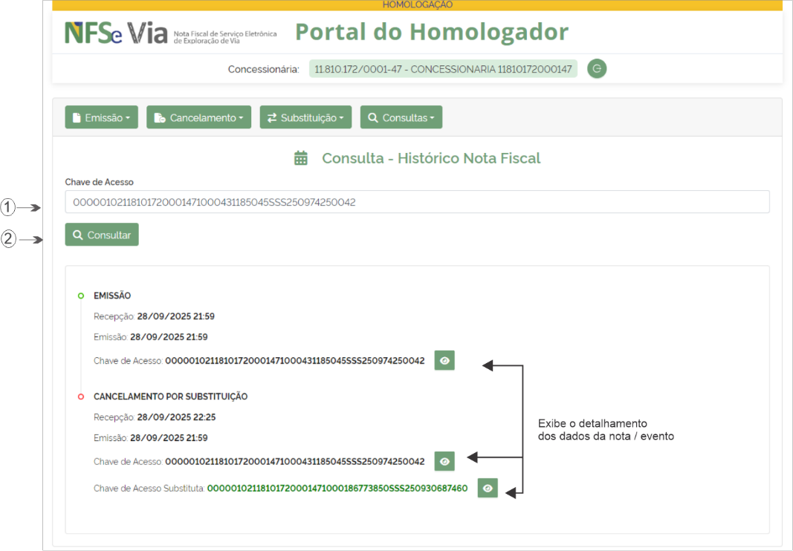

<!-- p.15 -->

# 4.6.1 Consulta – Consultar Histórico da NFS-e Via

Esta funcionalidade demonstra o processo de envio e os eventos associados a uma NFS-e, como cancelamento, substituição ou correção, e verifica se foram enviados e processados corretamente.
Ela permite que o homologador confirme a consistência dos dados e a integridade do processo, facilitando a detecção de falhas e garantindo que todas as etapas do fluxo da nota estejam corretas.

Como funciona na prática:

1. Acesse o menu Consultas – Histórico Nota Fiscal, informe a chave da nota/evento que deseja consultar.

<!-- p.16 -->

2. Ao clicar em “Consultar”,será exibido o histórico da NFS-e Via e sua cadeia de eventos se houver.

*Tela Consulta – Histórico Nota Fiscal: chave de acesso informada, com a cadeia de eventos (emissão, cancelamento por substituição e nota substituta) e o detalhamento de cada nota/evento.*
