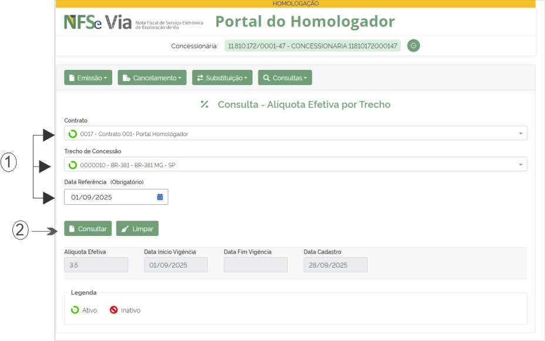

<!-- p.16 -->

# 4.7.1 Consulta – Consultar Alíquota Efetiva do Trecho

Esta funcionalidade permite validar a API durante a homologação, de consulta da alíquota efetiva aplicada a um trecho de pedágio.

<!-- p.17 -->

Ela possibilita:

- Confirmar que a API retorna a alíquota correta para o trecho informado a partir de uma data de vigência.
- Garantir que os dados enviados ou recebidos pela API estão consistentes com o que foi cadastrado no portal da concessionária, assegurando o cálculo correto do imposto.
- Facilitar testes e validação antes do uso em produção, assegurando integridade e precisão nas informações.

Como funciona na prática:

1. Acesse o menu Consultas – Alíquota Efetiva por Trecho, informe os dados solicitados, o Contrato, Trecho de Concessão e a Data para a qual deseja consultar a alíquota efetiva.
2. Ao clicar em “Consultar”,será exibido a alíquota efetiva aplicada ao trecho na data informada.

*Tela Consulta – Alíquota Efetiva por Trecho: Contrato, Trecho de Concessão e Data de Referência, com o resultado da alíquota efetiva e as datas de vigência.*
