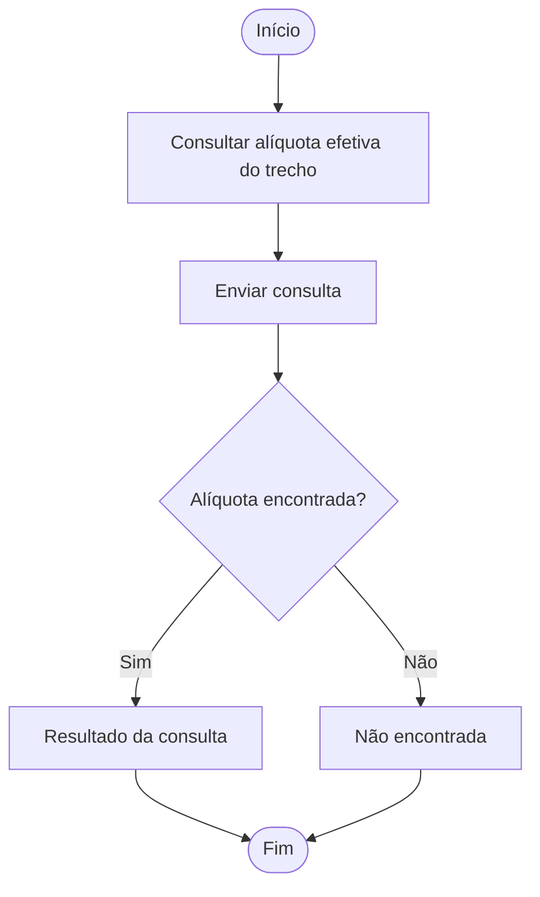

<!-- p.16 -->

# 4.7 Fluxo para homologação – Consultar Alíquota Efetiva do Trecho

*Para efetuar a consulta é necessário existir o cadastro do contrato / trecho para o CNPJ utilizado no perfil.*

*Informar contrato, trecho de concessão e data de referência (data em que está vigente).*
