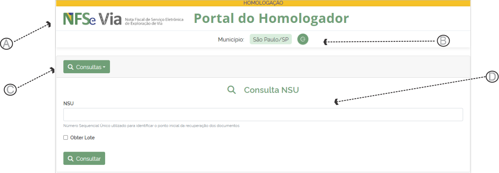
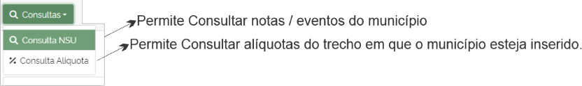

<!-- p.18 -->

# 5.1 Tela Inicial

Após seleciona o município a tela inicial está organizada nos seguintes elementos:

*Tela inicial do perfil Município, com os elementos A (logo), B (perfil do município), C (menu de acesso) e D (área central).*

A – Logo da aplicação: Identificação do sistema.

B – Perfil do Município: Exibe nome do município logado e botão que direciona para tela de entrada com as opções de alteração de perfil.

C – Menu de acesso: Agrupado por assunto com submenus das funcionalidades.

**Consultas**

D – Área Central (Painel Principal): Consulta que permite listar todas as notas / eventos recebidos do município.
