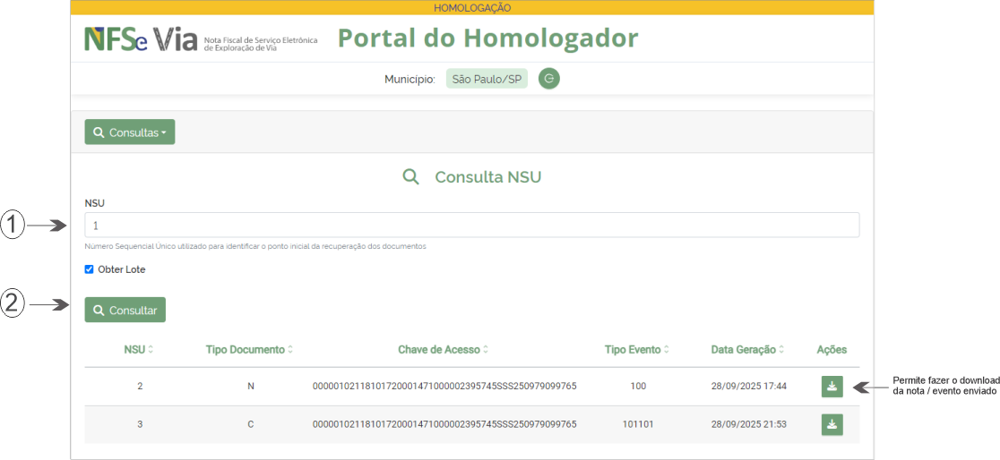

<!-- p.19 -->

# 5.2.1 Consulta – Consultar Notas/ Eventos do Município

Esta funcionalidade permite validar a API durante a homologação, verificando se as NFSe-Via e eventos associados foram recebidos e NSU gerados corretamente para o município.

O sistema retornará uma lista completa de notas e eventos enviados do município, permitindo acompanhar e validar o retorno da API.

Como funciona na prática:

1. Acesse o menu Consultas – Consulta NSU, informe Número Sequencial Único utilizado para identificar o ponto inicial da recuperação dos documentos.
2. Ao clicar em “Consultar”,será exibido a lista com todas as notas / eventos. Caso a opção obter lote não esteja marcado, será retornado apenas o documento do NSU informado.

<!-- p.20 -->

*Tela Consulta NSU: NSU informado, opção Obter Lote e lista de notas/eventos (NSU, tipo de documento, chave de acesso, tipo de evento e data de geração), com download de cada documento.*
