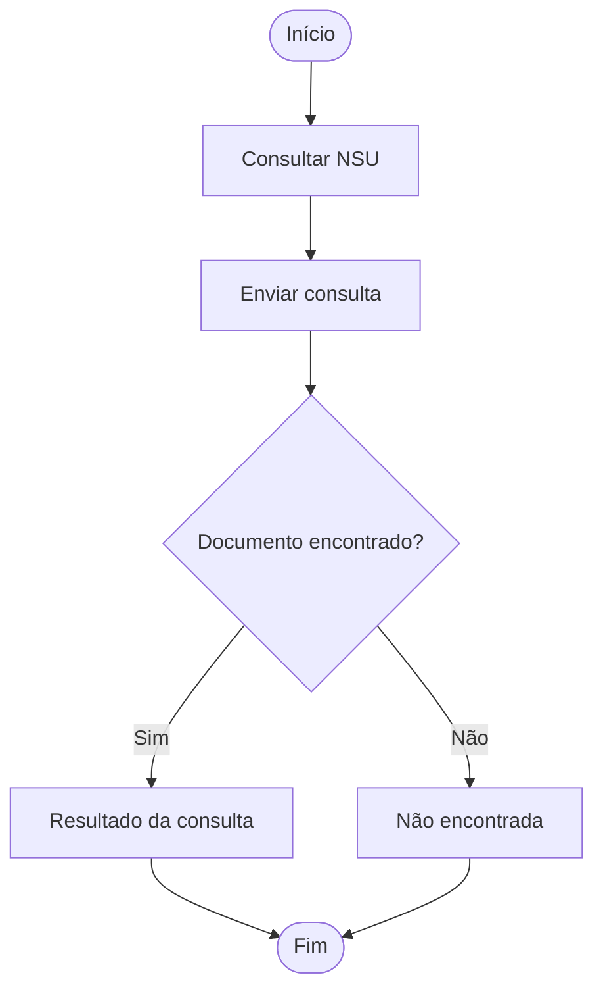

<!-- p.19 -->

# 5.2 Fluxo para homologação – Consultar Notas / Eventos do Município

*Informe o Número Sequencial Único (NSU) utilizado para identificar o ponto inicial da recuperação dos documentos.*
