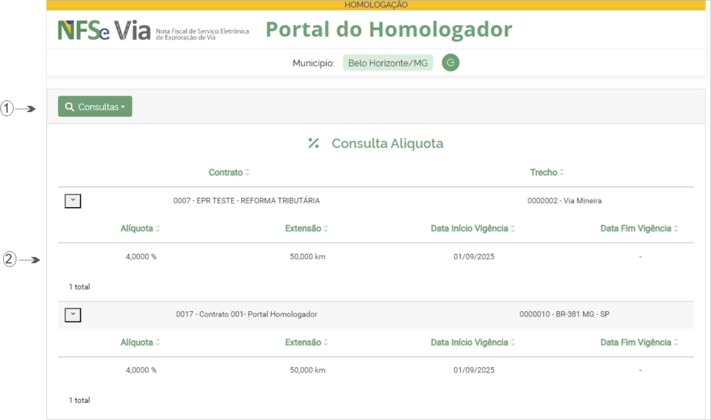

<!-- p.20 -->

# 5.3.1 Consulta – Consultar Alíquota do Município por Trecho

Esta funcionalidade permite listar todas as alíquotas aplicáveis aos trechos de pedágio que possuem o município informado.

Ela possibilita:

- Validar que os valores das alíquotas estão corretos para todos os trechos de um município.

<!-- p.21 -->

- Facilitar a homologação da API, garantindo que o sistema retorne as alíquotas corretas.
- Oferecer uma visão completa das alíquotas vigentes, permitindo verificar consistência e integridade dos dados relacionados a cada trecho do município.

Como funciona na prática:

1. Acesse o menu Consultas – Consulta Alíquota, a consulta será executada.
2. Listar todas os contratos, trechos e as alíquotas aplicáveis do Município

*Tela Consulta Alíquota: lista de contratos, trechos e alíquotas aplicáveis ao município, com a alíquota de cada trecho e o total de registros.*
