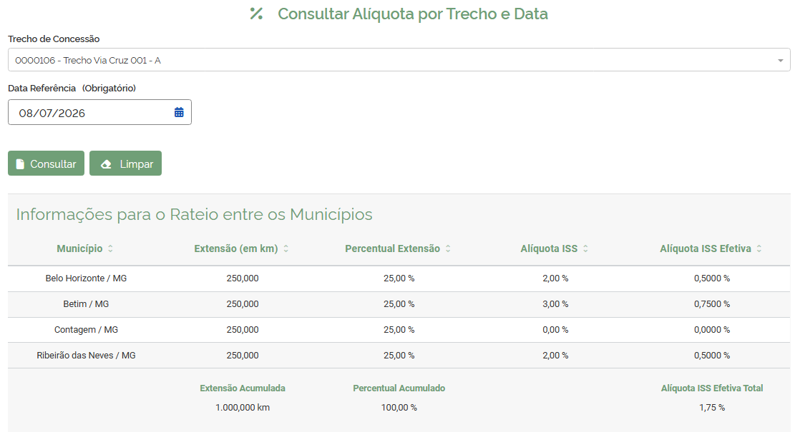

<!-- p.11 -->

# 4. Exemplo de cálculo do rateio do ISS para o município.

Para um trecho hipotético – Via Cruz, que passa em 4 municípios. O trecho tem 25 da estrada em cada um dos municípios, mas com alíquotas de ISS diferentes para cada um deles.

**Percentual de rateio:**

Exemplo com uma cobrança de Pedágio no valor de R$ 30,00.

Valor total de ISS = R$ 30,00 x 1,75% = R$ 0,53

| Município | Alíquota ISS Efetiva (%) | Percentual de Rateio | Valor de ISS (R$) |
|---|---|---|---|
| Belo Horizonte / MG | 0,50 | 0,50/1,75*100 = 28,57142857% | 0,15 |
| Betim / MG | 0,75 | 0,75/1,75*100= 42,85714286% | 0,23 |
| Contagem / MG | 0,00 | 0 | 0 |
| Ribeirão das Neves / MG | 0,50 | 0,50/1,75*100 = 28,57142857% | 0,15 |
| total | 1,75 | | 0,53 |
