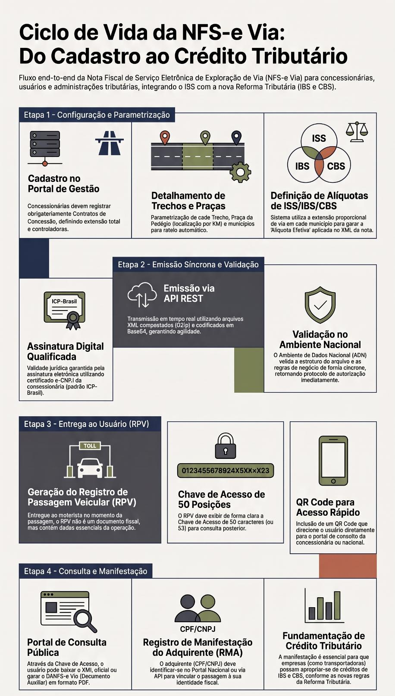

<!-- p.04 -->

# 1. Introdução

**Nota Fiscal de Serviço de Exploração de Vias – NFS-e Via**

A Nota Fiscal de Serviço de Exploração de Vias (NFS-e Via) é parte do Sistema Nacional da Nota Fiscal de Serviço. Documento fiscal a ser emitido quando o serviço prestado for do tipo 220101 - Serviços de exploração de rodovia mediante cobrança de preço ou pedágio dos usuários, envolvendo execução de serviços de conservação, manutenção, melhoramentos para adequação de capacidade e segurança de trânsito, operação, monitoração, assistência aos usuários e outros serviços definidos em contratos, atos de concessão ou de permissão ou em normas oficiais.

Mais informações, consultar a página na NFS-e Via no Portal Nacional da NFS-e: <https://www.gov.br/nfse/pt-br>.

O presente documento orienta os adquirentes do serviço de exploração de via (usuários de rodovias pedagiadas) sobre os procedimentos para a inclusão do Evento de Manifestação do Adquirente na Nota Fiscal de Serviço eletrônica de Exploração de Via (NFS-e Via). Ele detalha o funcionamento da NFS-e Via sob a perspectiva do, com base nas diretrizes técnicas e resoluções do Comitê Gestor da Nota Fiscal de Serviço.
<!-- REVISAR p.04: na fonte falta a palavra após "perspectiva do" (texto "sob a perspectiva do, com base..."); transcrito literalmente -->

- **Destinação:** Pessoas Físicas, Microempreendedores Individuais (MEI), Pessoas Jurídicas (frotistas e transportadoras) e Concessionárias de Rodovias.
- **Finalidade Fiscal:** Identificar formalmente o tomador do serviço no Ambiente de Dados Nacional (ADN) para fundamentar a comprovação de despesas e assegurar o direito ao creditamento dos tributos não cumulativos (IBS e CBS) na apuração assistida.

<!-- p.05 -->

A figura abaixo mostra todo o ciclo da NFS-e Via, desde a emissão da NFS-e pelo fornecedor do serviço de exploração de via, até a emissão da Manifestação do Adquirente pelo usuário (adquirente) do serviço.

