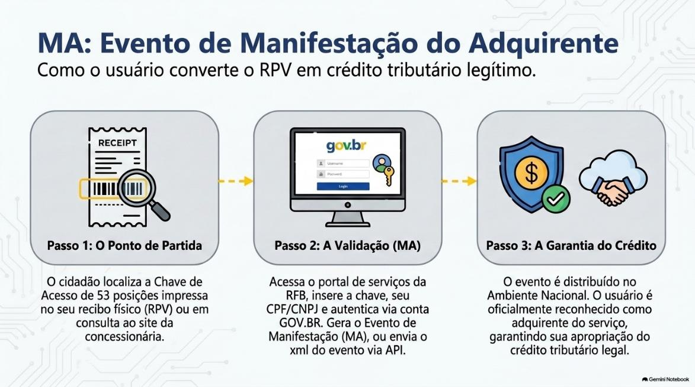

<!-- p.06 -->

# 2. Evento de Manifestação de Adquirente

<!-- REVISAR p.06: a figura do Passo 1 informa "Chave de Acesso de 53 posições", enquanto o texto da mesma página e das seções seguintes indica chave de 50 posições; transcrito conforme a fonte -->
