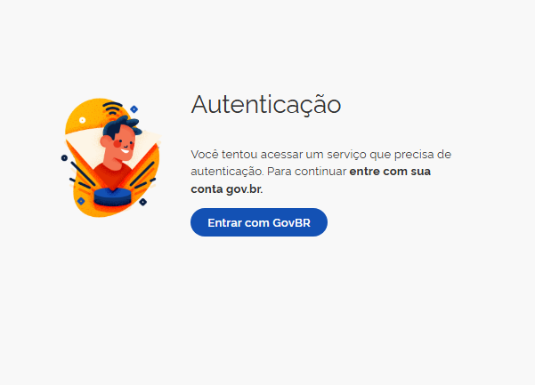
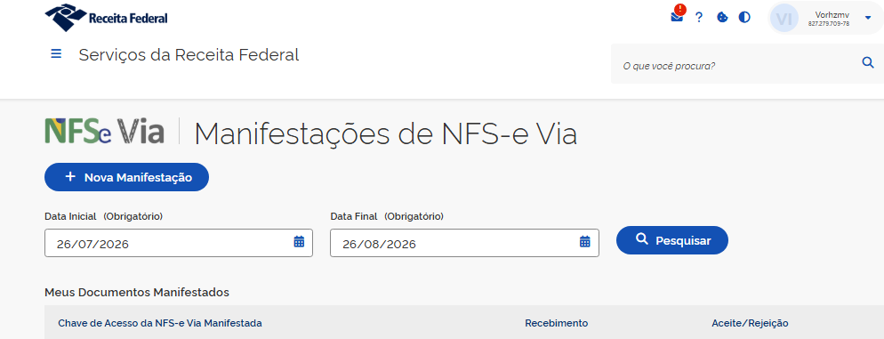
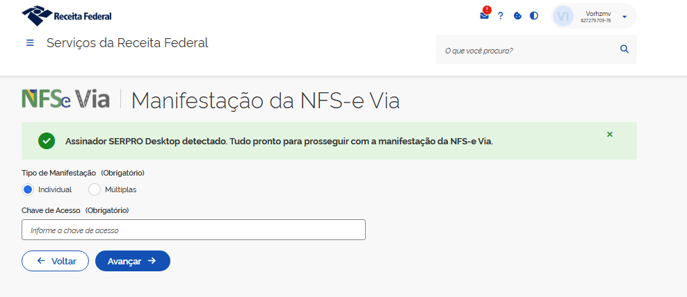
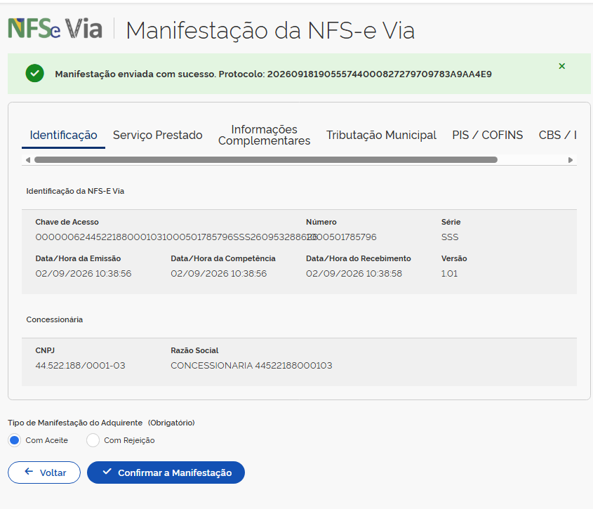
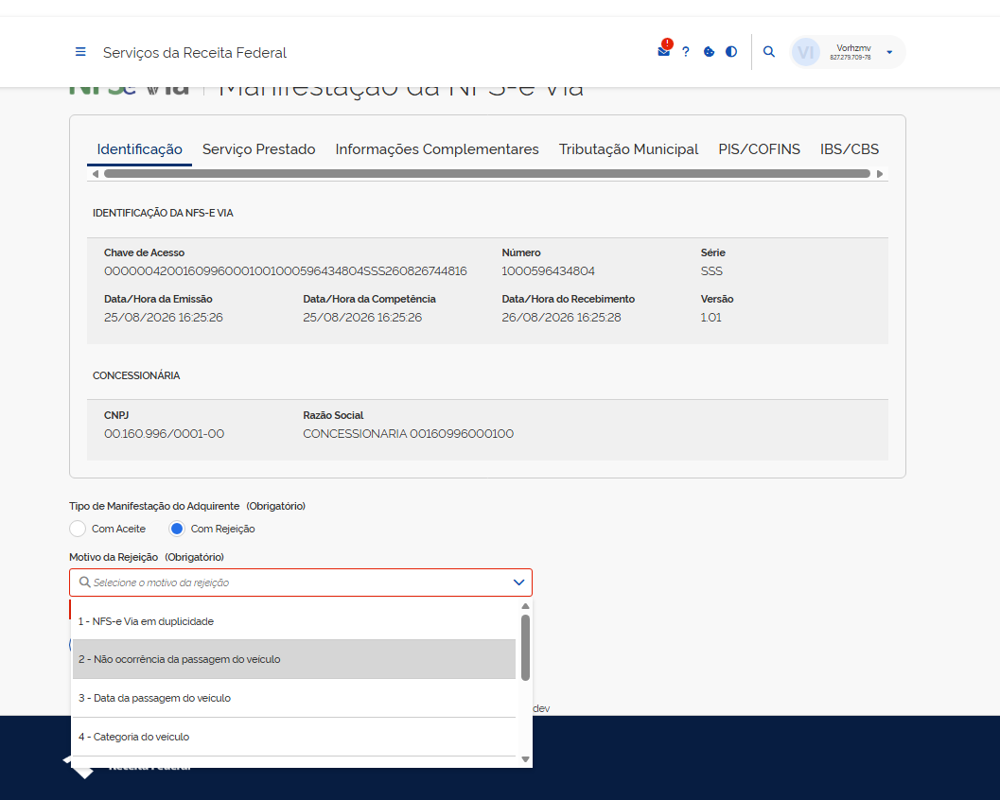
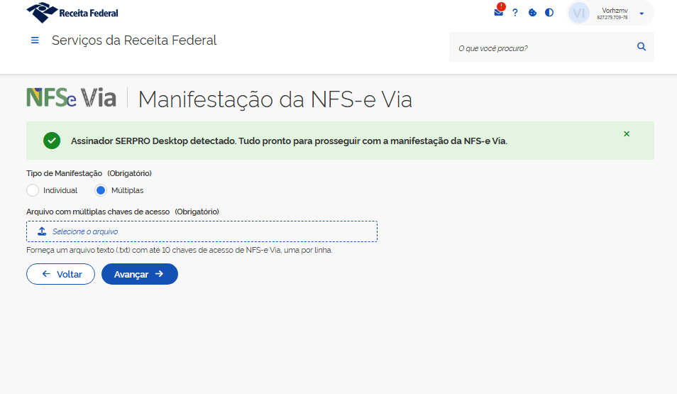
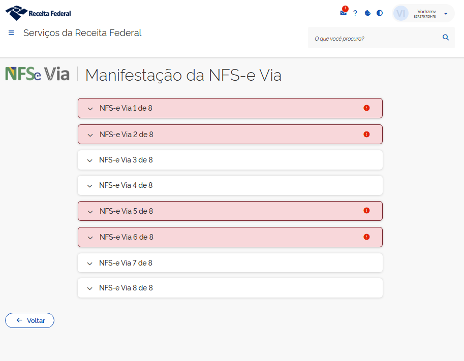
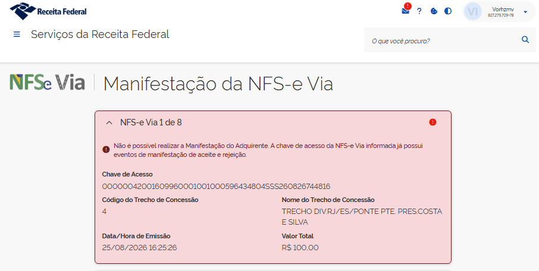
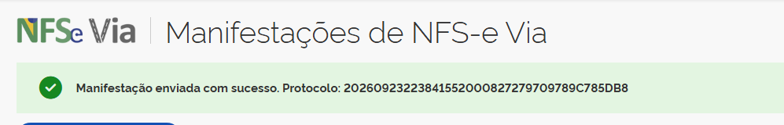
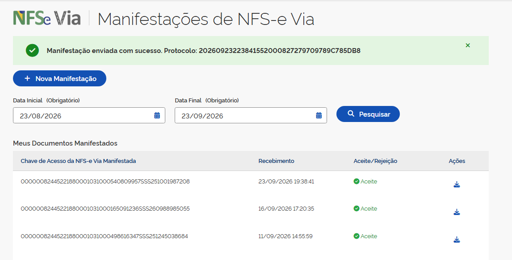

# 4. Telas do Portal de Serviços

Para os adquirentes (motoristas, MEIs e empresas) que realizam a inclusão do evento de manifestação de forma manual ou em lote pelo navegador web, o portal disponibiliza as seguintes telas:

## Telas 1 e 2: Autenticação e Acesso ao Sistema (Login)

<!-- p.10 -->

- **URL de Acesso:** <https://portal-servicos-nfsevia.estaleiro.serpro.gov.br/manifestacao>
- **Objetivo:** Garantir a identificação segura e a validade jurídica do responsável pelo registro da manifestação.
- **Elementos da Tela:**
    - Botão "Entrar com GOV.BR": Direciona para o login simplificado da plataforma GOV.BR, exigindo credenciais de nível Prata ou Ouro (ideal para Pessoas Físicas, MEIs e procuradores).
    - Botão "Acesso com Certificado Digital": Permite a autenticação mútua via certificado digital e-CPF ou e-CNPJ (tipos A1 ou A3).
- O usuário acessa a página inicial e escolhe a forma de autenticação. Após a validação das credenciais pelo sistema, o perfil do adquirente é carregado automaticamente na sessão.

## Telas 3: Painel Principal / Seleção de Serviço (Home)

- Apresenta as opções de navegação e atalhos para os serviços disponíveis ao adquirente.
- **Elementos da Tela:**
    - Nova Manifestação – inclusão da Manifestação;
    - "Meus Documentos Manifesta": Lista o histórico de eventos já registrados para aquele CPF/CNPJ, com a possibilidade de download do XML gerado;

<!-- p.11 -->

## Telas 4 a 6: Seleção de Serviço

- Apresenta as opções de Tipo de Manifestação – Individual ou Múltipla.
    - Cartão de Serviço 1 – "Manifestação Individual": Atalho para digitar e manifestar uma única chave de nota por vez.
    - Cartão de Serviço 2 – "Manifestação em Lote Web": Atalho para enviar conjuntos de até 10 chaves de nota simultaneamente.
- O usuário seleciona a modalidade de envio desejada conforme o volume de notas que possui para registrar.
    - Se optar pela Individual, deve informar a chave da NFS-e Via para a qual deseja realizar a manifestação;
    - Informar se a Manifestação é de "aceite" (os dados da NFS-e Via estão corretos), ou de "Rejeição" (alguma informação da NFS-e Via não está correta). Neste caso deve informar o motivo da Rejeição.

<!-- p.12 -->

- Ou, caso optar pela opção "Múltiplas", será mostrada a opção importar arquivo .txt/.csv contendo até 10 chaves de acesso de NFS-e Via.

<!-- p.13 -->

## Telas 7 e 8: Lista de Lote de Chaves e validação

- Acionar o botão "Avançar": Processa todas as chaves válidas da tabela em uma única operação.
- O Sistema lista cada chave informada e mostra um indicador visual de integridade (*Chave Válida*, *Tamanho Incorreto* ou *Nota Já Manifestada*).
- Deve-se informar em cada uma delas se é de "Aceite" ou "Rejeição", neste caso informar o motivo individualmente.

<!-- p.14 -->

## Tela 9: Confirmação do envio

- O sistema exigirá que cada Manifestação seja assinada com o Certificado Digital ou assinatura Gov.br.
- Então dará o retorno da(s) Manifestações registradas.

## Tela 10: Download do xml

- Após a emissão da Manifestação, é possível fazer o download do XML gerado no ícone disponível.

