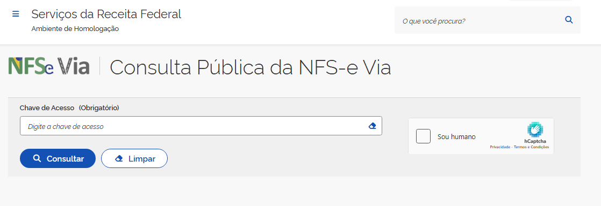
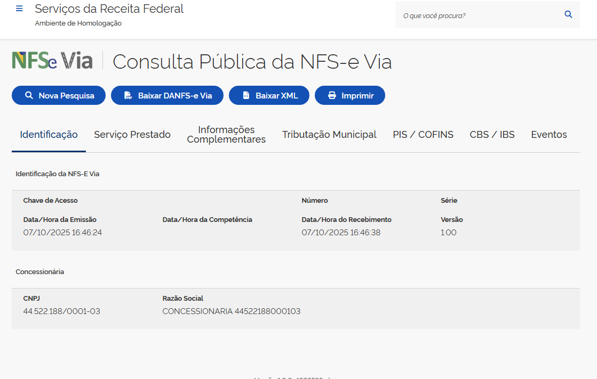
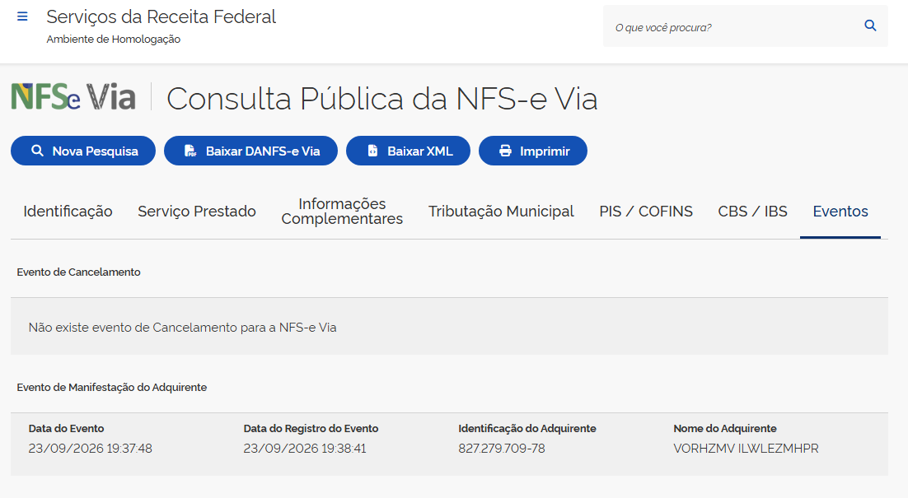
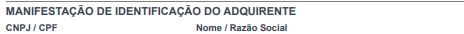

<!-- p.15 -->

# 5. Consulta Pública da Manifestação

É possível fazer a consulta pública da NFS-e Via, dos eventos vinculados a ela e do DANFS-e Via no Portal de Consulta Pública da NFS-e Via no Portal de Serviços da RFB.

<https://portal-servicos-nfsevia.estaleiro.serpro.gov.br/consultapublica/>

Informa a Chave da NFS-e Via e mostrará na tela um resumo dos dados, disponibiliza o download do xml da NFS-e Via e do DANFS-e Via.

<!-- p.16 -->

Se baixar o DANFS-e Via, o nome do Adquirente aparecerá no campo Manifestação de Identificação do Adquirente.

