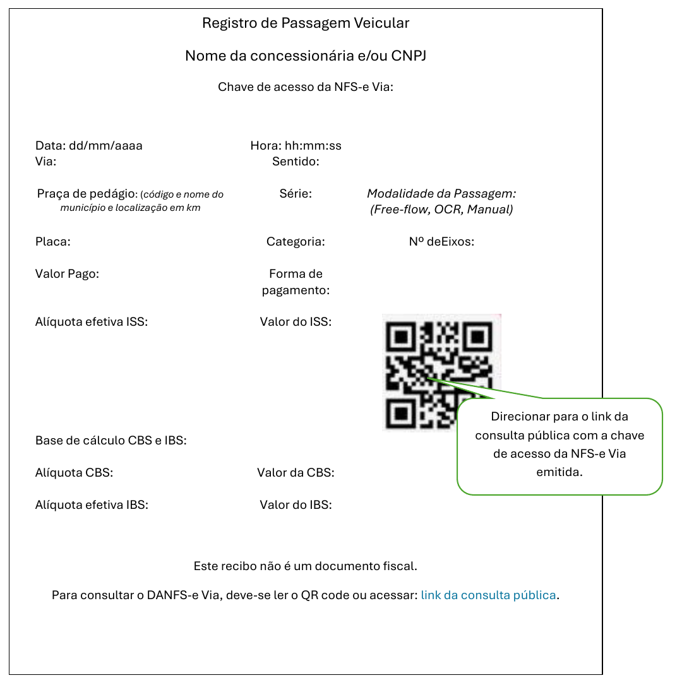

<!-- p.09 -->

# 5.1 Exemplo de RPV

*Exemplo de Registro de Passagem Veicular (RPV), conforme modelo da página 9 do manual.*

Campos apresentados no modelo:

- Registro de Passagem Veicular
- Nome da concessionária e/ou CNPJ
- Chave de acesso da NFS-e Via
- Data: dd/mm/aaaa
- Hora: hh:mm:ss
- Via
- Sentido
- Praça de pedágio (código e nome do município e localização em km)
- Série
- Modalidade da Passagem (Free-flow, OCR, Manual)
- Placa
- Categoria
- Nº de Eixos
- Valor Pago
- Forma de pagamento
- Alíquota efetiva ISS
- Valor do ISS
- Base de cálculo CBS e IBS
- Alíquota CBS
- Valor da CBS
- Alíquota efetiva IBS
- Valor do IBS

Campo de QR code, com a indicação: "Direcionar para o link da consulta pública com a chave de acesso da NFS-e Via emitida."

Textos do modelo:

- Este recibo não é um documento fiscal.
- Para consultar o DANFS-e Via, deve-se ler o QR code ou acessar: link da consulta pública.
